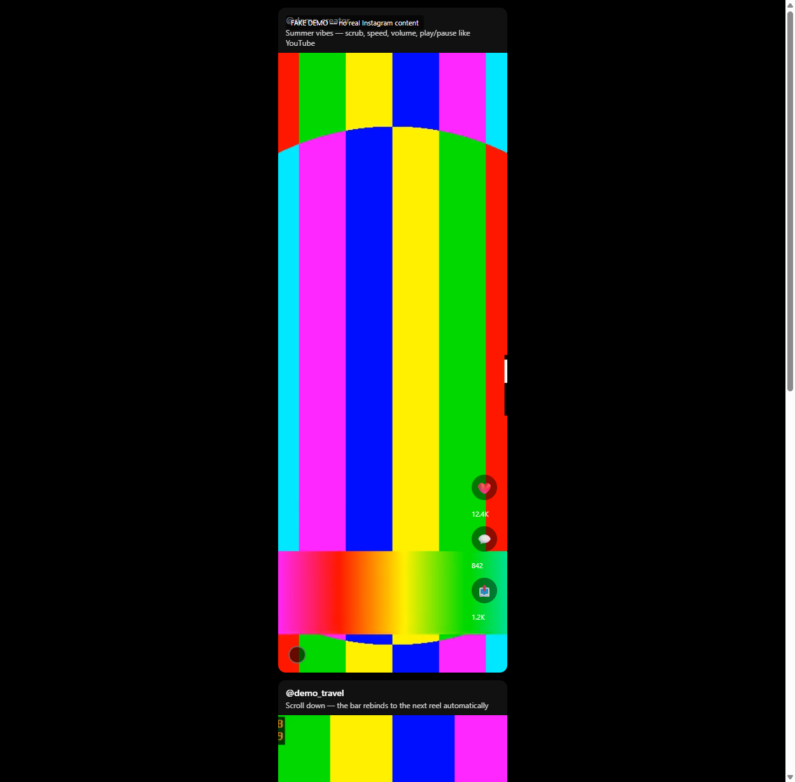
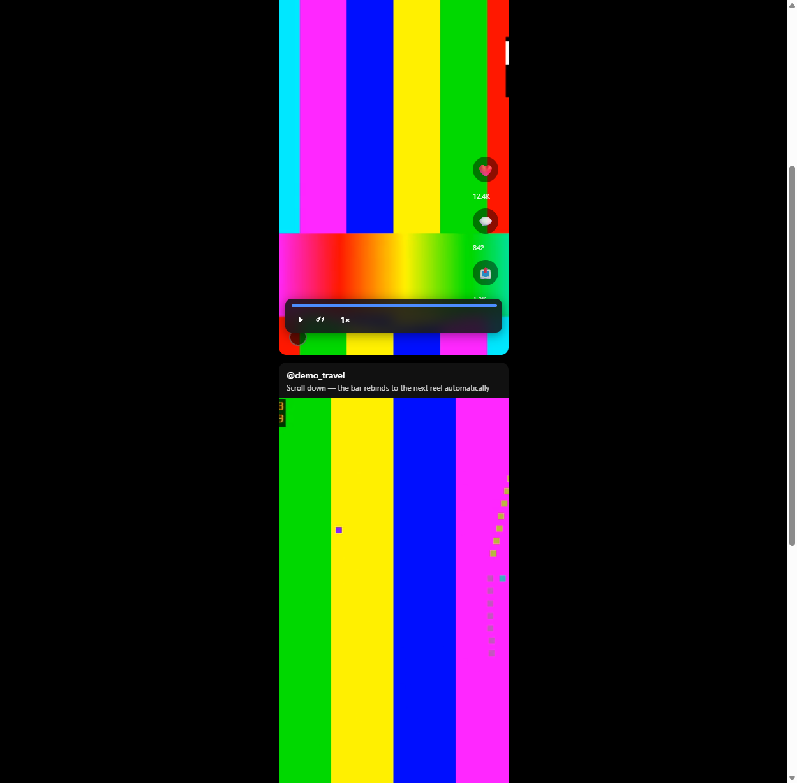
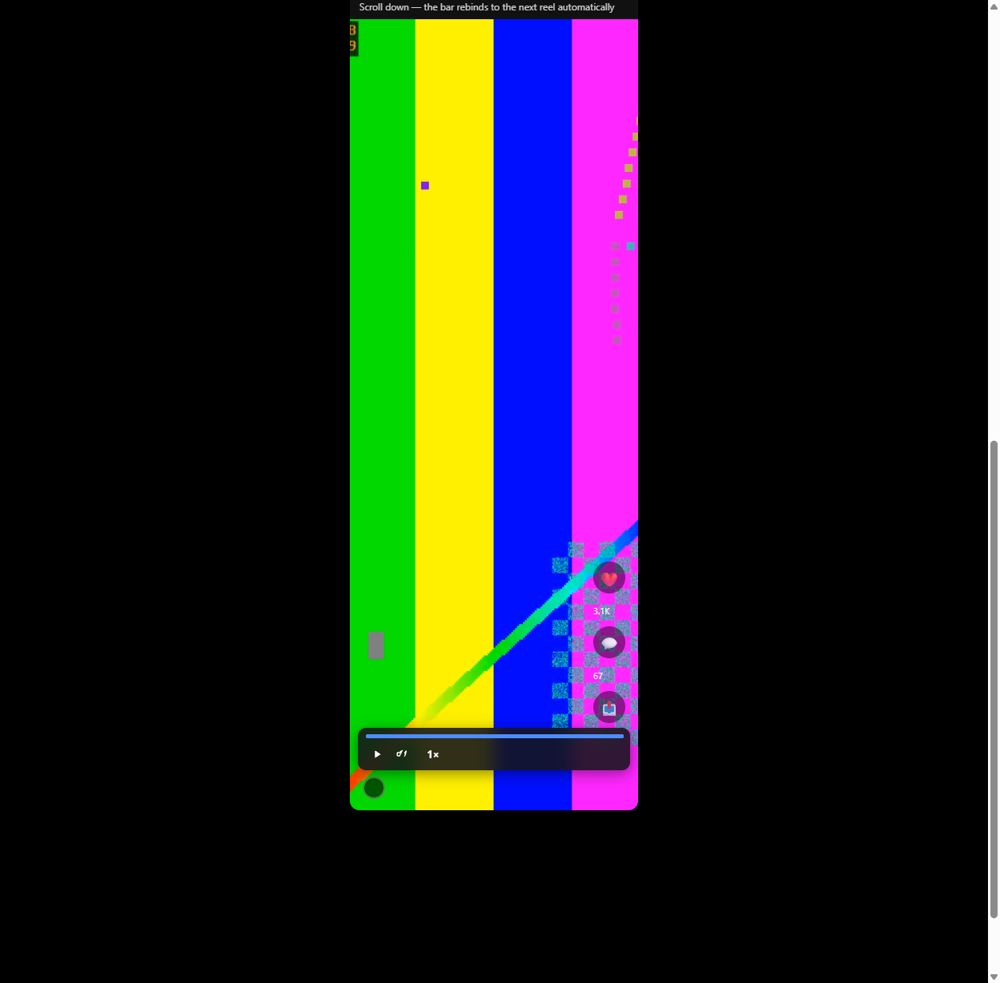
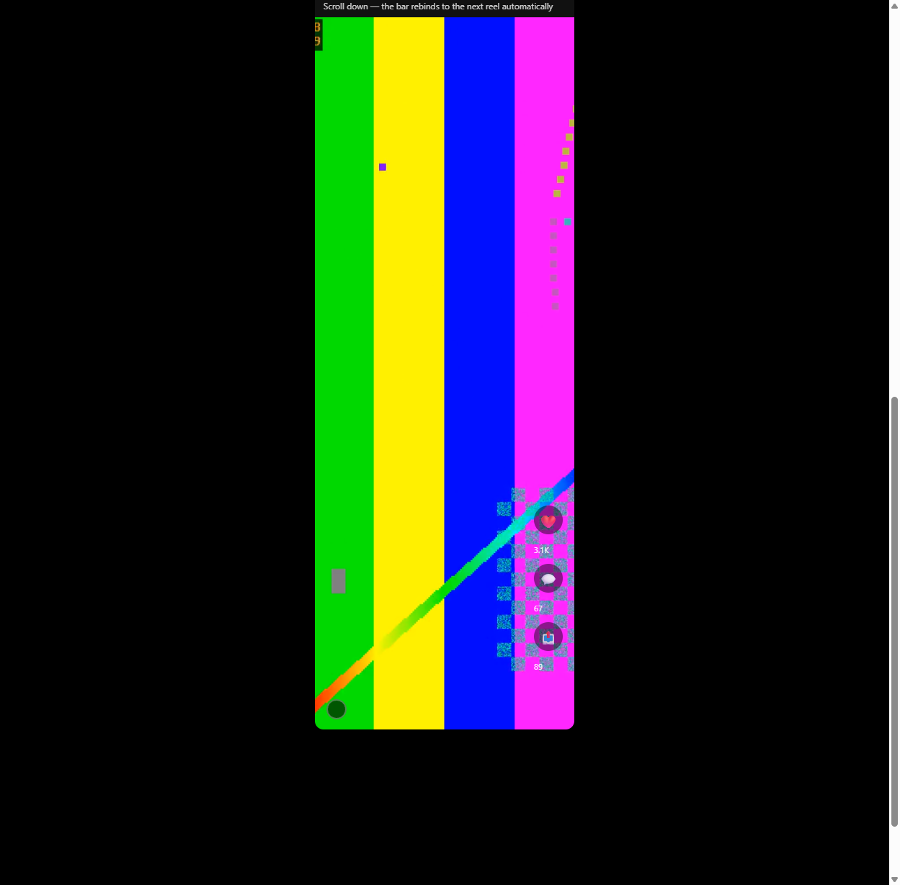

# Instarols

> **YouTube-style controls for Instagram Reels.** Scrub the timeline like YouTube, control volume, choose playback speed, and play/pause — with an intent-based reveal that only shows when you need it.

## Why it exists

Instagram Reels has no timeline scrubber, no speed picker, and its volume control is buried. If you want to re-watch a moment, slow down a tutorial, or adjust volume without hunting for the native mute button, you're stuck. Instarols adds a YouTube-style player bar that overlays the active reel — nothing more, nothing less.

## What it does

| Feature | What it does |
| :--- | :--- |
| 📼 **Timeline scrubber** | Drag to any point in the reel, just like YouTube. Shows buffered range and a hover tooltip with the timestamp. |
| 🔊 **Volume control** | Slider from 0–100% with a mute toggle. Your last volume is remembered per session and across reloads. |
| ⚡ **Playback speed** | 0.25× to 2× speed picker. Your preferred speed persists as the default for future reels. |
| ▶️ **Play / pause** | Dedicated toggle that mirrors the video's real state. |
| 👁️ **Intent-based reveal** | The bar stays hidden until you move your pointer toward the lower section of the reel — then it slides in. Hides on idle, leave, or scroll. |
| 📱 **Responsive** | Recomputes layout on window/video resize. Auto-hides when the viewing area is too small. Explore-grid preview tiles never get controls — only the engaged reel does. |
| 🚫 **No collisions** | Never overlaps Instagram's native audio/mute controls. The native mute button stays fully clickable. |

## Screenshots tour

  
  
  
  
  

- **Clean state** — the bar is completely hidden until you approach the lower section of the reel.
- **Hero revealed** — all four controls visible: play/pause, mute, volume slider, speed picker, and timeline scrubber.
- **Volume active** — slider at 60% with fill indicator.
- **Speed menu** — 0.25×–2× speed options with the active speed highlighted.
- **Scrubber active** — dragging the playhead commits the seek on release (no frame-by-frame seeking that stutters the stream).

## How it works

Instarols is a **Manifest V3 Chrome/Edge/Firefox extension** with zero dependencies and no build step:

1. **Video tracker** (`content/video-tracker.js`) — finds the engaged `<video>` element using geometry heuristics only. Never relies on Instagram's class names, which change constantly.
2. **Overlay shell** (`content/ui.js`) — shadow-DOM control bar positioned under the active video. Intent-based reveal (120ms settle), responsive `ResizeObserver` loop, and a collision guard that lifts the bar clear of any widget underneath.
3. **Controls** — play/pause, volume, speed, and scrubber modules each bind to the active video's real events (`play`, `pause`, `volumechange`, `ratechange`, `timeupdate`), so the UI always reflects reality.
4. **Persistence** — volume and default speed are saved in `browser.storage.local`, so they survive reloads *and* scrolling to the next reel.

## Installation

### Chrome / Edge

1. Go to `chrome://extensions` (or `edge://extensions`).
2. Enable **Developer mode**.
3. Click **Load unpacked** and select this project folder (`instarols/`).
4. Pin the extension to your toolbar.

### Firefox

1. Go to `about:debugging#/addons/this-firefox`.
2. Click **Load Temporary Add-on** and select `manifest.json`.

> Instagram requires you to be logged in to view Reels. Instarols works on `instagram.com/reels/*` only — no other host permissions are requested.

## Configuration

Instarols has no settings page. Everything is configured through the controls themselves:

- **Volume** — drag the slider; your last level is remembered.
- **Speed** — pick from the menu; your choice becomes the default for future reels.
- **Rebind** — scroll to a new reel and the bar transfers automatically.

## Privacy / Safety

- No server, no analytics, no tracking. Volume and speed are stored locally via `browser.storage.local`.
- Host permission is limited to `instagram.com` — the extension cannot read or modify any other site.
- Your login session is never touched; Instarols only overlays UI on the page you're already viewing.

## Browser support

| Browser | Status |
| :--- | :--- |
| Chrome | ✅ Verified |
| Edge | ✅ (Chromium, same as Chrome) |
| Firefox | ✅ (via `about:debugging`; addons.mozilla.org publishing pending) |
| Safari | ❌ Not covered — requires separate Apple Developer / App Store packaging |

## Tags / Topics

`instagram-reels` `video-controls` `playback-speed` `volume-control` `timeline-scrubber` `chrome-extension` `firefox-extension` `browser-extension` `instagram` `reel` `video-player` `youtube-style-scrubber` `manifest-v3` `userscript`

## License

MIT — see [LICENSE](LICENSE).
